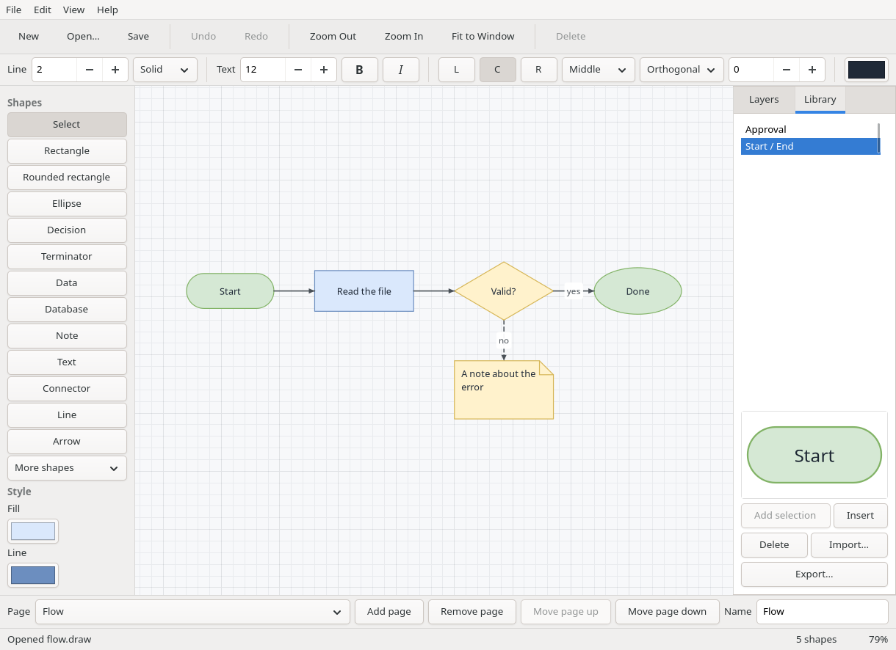

# Bintana Draw

A diagram editor for the desktop: boxes, decisions, notes and connectors on an
infinite canvas, in one Bintana window and nothing else. A sibling of the
[Bintana](https://github.com/getbintana/bintana) tree, not part of it.



It is the shape a person reaches for when the drawing is a flowchart rather
than a document: drag a rectangle, drag a diamond beside it, join them with an
arrow, double-click to write inside. Save the result as a `.draw` file that is
plain JSON, or export a PNG or a PDF to put in a mail.

## Running it

With a built `bintana` (on your `PATH`, or `build/bintana` from a checkout):

```sh
bintana bintana-draw
bintana bintana-draw examples/flow.draw
bintana bintana-draw examples/flow.drawio
```

The file is optional; it opens that diagram, and `File > Open` opens another.
A `.drawio` is imported and becomes an unsaved Bintana Draw diagram, so the
first Save asks for a `.draw` name instead of overwriting the original.
The window is started with a blank canvas and the shape palette on the left.

## What it does

- **Shapes** — rectangle, rounded rectangle, ellipse, decision diamond,
  terminator, data parallelogram, database cylinder, note and free text in the
  palette, plus a **More shapes** list: triangle, hexagon, document, manual
  input, predefined process, internal storage, delay, on-page and off-page
  references, loop limit, manual operation and AND/OR/XOR/NAND/NOR logic
  gates. Pick one and click for the default size or drag to size it.
- **Images** — **Image…** in the toolbar embeds a PNG, JPEG, WebP, TIFF, BMP
  or SVG (where the runtime can read it) into the diagram as a shape: it moves,
  resizes, rotates and saves with the file, and dropping an image on the window
  inserts it too. The picture is kept inside the `.draw` as base64, so the file
  travels alone.
- **Shape library** — the **Library** tab saves the current selection as a
  reusable stamp, shows it in a preview, inserts it at the centre of the view,
  and deletes it. The list groups stamps by where they came from — **My
  shapes**, an imported file or a downloaded set — and filters by name. The
  library lives in the application's config directory and can be exported as
  `.btlib`. **Import** accepts a `.btlib`, a `.draw`, an uncompressed
  `.drawio`/XML diagram, a draw.io stencil set (`<shapes>`), or a draw.io
  `.mxlibrary` with uncompressed `xml` entries. Stencil geometry is kept as
  vector paths, so the imported shapes resize without a picture. **Get
  stencils…** downloads a curated set into the library, grouped by category
  and filtered by name or shape word, with its license shown before the
  request.

- **Connectors** — the connector tool, dragged from one shape to another,
  produces an orthogonal route that follows both shapes when they move or
  resize. Connectors can be labelled and can be dashed.
- **Text** — double-click a shape or a connector and the editor opens over it.
  Enter or clicking away keeps the text; Escape puts it back.
- **Pages** — the bar under the canvas switches, adds, removes, reorders and
  names pages. Every page has its own layers and shapes; the whole book is
  saved, and the current page is what the canvas edits and the export writes.
- **Layers** — the panel on the right adds, removes and reorders layers, and
  names, hides or locks the active one. New shapes and connectors go to the
  active layer; a hidden layer is not drawn, hit-tested or exported, and a
  locked one is visible but cannot be selected. A selection can be sent to the
  active layer in one click.
- **Selection** — click, Shift-click, or drag a rubber band. Drag a selected
  shape to move the selection; drag a handle to resize the one shape selected.
  Shift constrains a move to one axis.
- **Style** — fill and line colour apply to the selection, and set the default
  for the next shape when nothing is selected. The format bar adds line width,
  solid/dashed/dotted lines, font size, bold and italic, text alignment and
  text colour.
- **Order** — `Edit > Order` and the canvas context menu bring the selection to
  the front or the back, or move it one step forward or backward inside its
  layer.
- **Groups** — `Ctrl+G` groups the selected shapes; one click then selects the
  whole group, moving it moves every member, and `Ctrl+Shift+G` ungroups. A
  group is drawn with one dashed box around its members, copies get a new group
  id, and the draw.io import keeps its groups.
- **Rotation** — the `Rotate` field turns a shape around its centre in degrees;
  its text, hit-test, bounds and connector anchors follow. A rotated shape has
  no resize handles: set `Rotate` back to 0 to resize it.
- **Free lines and arrows** — the `Line` and `Arrow` tools draw a segment with
  no shapes attached. A selected line shows a handle at each end: drag one to
  move just that end, drag the body to move both, and double-click an end to
  put or take away its arrowhead. Dragging an end over a shape shows its eight
  connection points; the nearest one lights up and the end attaches there.
  Drag an attached end into empty space to detach it. A connector may have one
  end attached and one loose. `Edit > Arrowheads` and the context menu
  set none, start, end or both on any selected connector. Lines can be
  labelled, styled, copied, pasted, and are included in the bounds and the
  export.
- **Connector routes** — a selected connector has a `Route` choice:
  orthogonal (the automatic right-angled path), straight, or curved. Select a
  connector and drag the hollow circle at its middle to add a bend; drag a bend
  to move it and double-click it to remove it. A connector with bends follows
  them, and the curved route is sampled into a smooth line for the painter, the
  hit test and the export.
- **Alignment** — while a shape is moved or resized, its edges and centre snap
  to the other shapes and a dotted guide shows why. `Edit > Align` lines up a
  selection; `Edit > Distribute` spaces its centres.
- **Undo and redo** — every gesture is one step: a drag through forty motions is
  one thing to take back, not forty. The title bar's dot is the unsaved mark.
- **View** — zoom in and out from the toolbar or with `+`/`-`, fit the diagram,
  pan with the middle button, scroll with the wheel, and toggle the grid from
  the View menu.
- **Files** — `.draw` is JSON, written atomically. An uncompressed draw.io
  file (`.drawio` or XML) can be imported and saved as a `.draw`; compressed
  draw.io pages are refused with the sentence that says how to re-export them
  as XML. The application asks before throwing unsaved work away; a diagram
  dropped on the window opens. Export is PNG (at twice the diagram's size) or
  A4 landscape PDF.
- **Spanish** — the whole interface is in `po/es.po`; run it with
  `LANGUAGE=es bintana bintana-draw`.

## Keyboard and mouse

| | |
|---|---|
| `Ctrl+N` / `Ctrl+O` / `Ctrl+S` / `Ctrl+Shift+S` | New, open, save, save as |
| `Ctrl+Z` / `Ctrl+Shift+Z` | Undo, redo |
| `Ctrl+X` / `Ctrl+C` / `Ctrl+V` / `Ctrl+D` | Cut, copy, paste, duplicate |
| `Delete` | Delete the selection |
| `Ctrl+A` | Select all shapes and connectors |
| `Ctrl+G` / `Ctrl+Shift+G` | Group / ungroup the selection |
| Double-click a line end | Toggle that end's arrowhead |
| Arrow keys / `Shift`+arrows | Move the selection 10 / 1 units |
| `+` / `-` / `0` | Zoom in, zoom out, actual size |
| Middle drag | Pan |
| Wheel | Scroll |
| Double-click | Edit the text of a shape or connector |

The Help menu has the same list.

## The `.draw` file

One object, two arrays, and numbers in canvas units on an unbounded plane:

```json
{
  "format": "bintana-draw/1",
  "version": 2,
  "active": 0,
  "pages": [
    {
      "name": "Flow",
      "layers": [
        { "id": "l1", "name": "Flow", "visible": true, "locked": false },
        { "id": "l2", "name": "Annotations", "visible": true, "locked": false }
      ],
      "shapes": [
        { "id": "s1", "kind": "rect", "layer": "l1", "group": "",
          "x": 40, "y": 40, "w": 160, "h": 70,
          "text": "Start", "fill": "#dae8fc", "stroke": "#6c8ebf",
          "strokeWidth": 2, "dash": "solid", "rotation": 0,
          "textColor": "#1f2937",
          "fontSize": 12, "radius": 12, "textBold": false,
          "textItalic": false, "textAlign": "center", "textVAlign": "middle" }
      ],
      "edges": [
        { "id": "e1", "from": "s1", "to": "s2", "layer": "l1", "text": "yes",
          "route": "orthogonal", "waypoints": [],
          "arrowStart": false, "arrowEnd": true,
          "stroke": "#6c8ebf", "strokeWidth": 2, "dash": "solid",
          "fontSize": 11, "textBold": false, "textItalic": false }
      ]
    }
  ]
}
```

An `image` shape carries its pixels as base64 in `image`; a `vector` shape
carries a stencil's box and path parts in `vector`; every other kind leaves
both empty. A file is read with `Document.fromJSON`, which refuses a foreign
`format`, clamps sizes, drops connectors whose ends are missing and renumbers
colliding ids. A file written before pages existed has its shapes at the top
level and opens as one page. That is also the whole of the format's
documentation.

## The project

```
Diagram.js       the document and its geometry -- no widgets
Stencil.js       draw.io stencil sets, read as vector library items
StencilCatalog.js what the stencil downloader may offer, and its terms
StencilsForm.*   the downloader's window: set, license, one request
Library.js       saved stamps, their insertion and every library importer
DrawioImport.js  an uncompressed draw.io diagram mapped onto a page
Render.js        the canvas and the export, as one painter routine
MainForm.form    the window: menus, toolbar, palette, canvas, status bar
MainForm.js      the hand: tool, selection, gesture, file, undo
ConfirmForm.*    save / discard / cancel
tests/selfcheck  a project that drives the real window and quits with a status
```

Two design notes worth knowing before changing it:

- **The canvas is a world with a transform.** `panX`, `panY` and `zoom` convert
  screen points once; shapes store world coordinates. An export sets
  `exporting`, and `Canvas_Draw` paints the same document fitted to white paper.
- **A `DrawingArea` has no natural size.** HAlign Fill leaves it at the width it
  was declared with, so `fitCanvas()` copies the stage's allocation into it
  whenever the stage changes size.

## Checking it

```sh
bintana check .
bintana check --strict .
bintana check tests/selfcheck
```

The self-check opens the real form under a virtual display and drives it through
the handlers the runtime would call -- drags a rectangle, connects it, edits its
text, saves and reopens the file, undoes and redoes -- then prints a count and
quits with `0` or `1`:

```sh
xvfb-run -a bintana tests/selfcheck
```

It also asserts that every handler the window depends on is wired, because a
handler whose control name is misspelled is silently dead.

## What it does not do yet

This is a first editor, not a draw.io replacement. Missing, in the order they
would change what a person can draw: a draw.io diagram that names a stencil
without carrying its XML, library thumbnails, AWS/Azure/GCP icon libraries,
system-clipboard interchange with other applications, SVG import/export, and
collaboration.

The draw.io import is deliberately the basic half: it reads every uncompressed
page of a file, maps the common shapes by style (`rounded`, `ellipse`,
`rhombus`, `shape=note`, `shape=terminator`, `shape=parallelogram`,
`shape=cylinder3`), keeps fill and stroke colours, labels, dashed edges, the
draw.io layers, the page names, the group membership and image cells whose
pixels are inline as base64. Stencil sets are imported into the library; a
diagram that only names `shape=mxgraph...` is not resolved, because the file
carries no geometry for it. It does not read compressed pages, rotation, images
referred to by a path or URL, or a group cell's own label and style.
There is no autosave and no recovery file; the unsaved-changes question is the
whole of the safety net.

## Third-party stencils

No stencil XML, icon set or vendor artwork is stored in this repository.
`Get stencils…` fetches a set from its public source when the person asks for
it.

The downloader is deliberately curated. It offers the generic draw.io sets,
Kubernetes (Apache 2.0 or CC BY 4.0) and IBM Cloud (Apache 2.0), with the
license and source beside each one. AWS, Azure and Google Cloud sets are not
offered: their terms allow architecture diagrams and documentation, not
redistribution as an application's asset library. The draw.io stencil terms are
not Apache 2.0 and carry an Atlassian-product restriction; they travel in
`StencilCatalog.js` and are shown in the window.

Exporting a `.btlib` that contains downloaded shapes hands those assets to
whoever receives it. That is the person's copy to share or not, and the license
of each set still applies.

The catalog points at the public draw.io endpoint:

```text
https://viewer.diagrams.net/stencils/
```

Names are in `StencilCatalog.js`. A set that is not there is not downloaded by
the application, even if the endpoint has it.

## Licence

MIT — see [LICENSE](LICENSE).

Bintana itself is MIT; QuickJS-ng and GTK4 carry their own licences.
